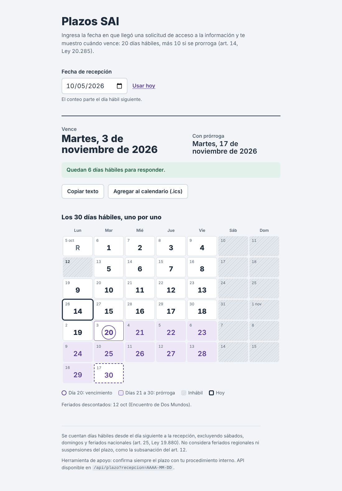
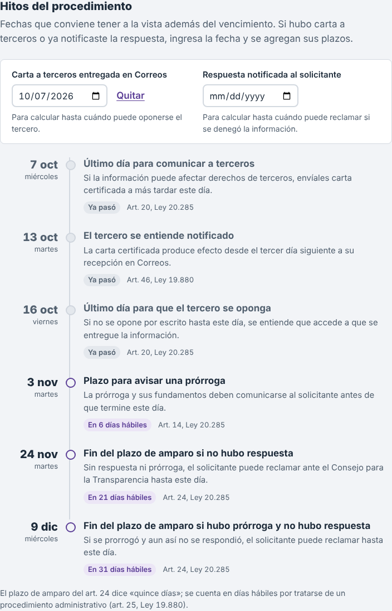

# Plazos SAI

[](https://github.com/gadiiiiii/plazos-sai/actions/workflows/ci.yml)

Calculadora del plazo de respuesta de una **solicitud de acceso a la información pública** (SAI) en Chile, según la Ley 20.285.

Ingresas la fecha de recepción y obtienes:

- **Vencimiento**: 20 días hábiles (art. 14).
- **Vencimiento con prórroga**: 10 días hábiles adicionales.
- Cuántos días hábiles quedan desde hoy, o hace cuántos venció.
- Los **hitos del procedimiento**: plazo para comunicar a terceros, para avisar una prórroga y para que el solicitante reclame ante el Consejo para la Transparencia.
- Un calendario con los 30 días hábiles numerados, fines de semana y feriados marcados.
- Texto listo para copiar y un archivo `.ics` para agregar ambos vencimientos a tu calendario.



## Cómo se cuenta el plazo

- Los días hábiles se definen en el art. 1 N°3 de la Ley 20.285, que remite al art. 25 de la Ley 19.880.
- El conteo parte el **día siguiente** a la recepción.
- Son inhábiles los **sábados, domingos y feriados nacionales**.
- Los feriados están en [`lib/feriados.ts`](lib/feriados.ts) para 2025, 2026 y 2027. Si el cálculo cae en un año no cargado, la app lo advierte.

**No considera**: feriados regionales ni suspensiones del plazo (por ejemplo, mientras se espera la subsanación del art. 12). Es una herramienta de apoyo; confirma siempre con tu procedimiento interno.

## Hitos del procedimiento

| Hito | Cómo se calcula | Norma |
|---|---|---|
| Último día para comunicar a terceros | Recepción + 2 días hábiles | Art. 20, Ley 20.285 |
| Aviso de prórroga | Antes de que termine el día 20 | Art. 14, Ley 20.285 |
| Fin del plazo de amparo sin respuesta | Vencimiento (20 o 30 días) + 15 días hábiles | Art. 24, Ley 20.285 |
| Tercero notificado *(opcional)* | Entrega en Correos + 3 días hábiles | Art. 46, Ley 19.880 |
| Fin de la oposición del tercero *(opcional)* | Notificación + 3 días hábiles | Art. 20, Ley 20.285 |
| Fin del plazo de amparo contra la respuesta *(opcional)* | Notificación de la respuesta + 15 días hábiles | Art. 24, Ley 20.285 |

Los hitos opcionales aparecen al ingresar la fecha de entrega de la carta en Correos o la de notificación de la respuesta. El art. 24 dice "quince días" sin precisar; se cuentan hábiles por tratarse de un procedimiento administrativo.



## API

```
GET /api/plazo?recepcion=2026-10-05
GET /api/plazo?recepcion=2026-10-05&hoy=2026-10-26
GET /api/plazo?recepcion=2026-10-05&tercero=2026-10-07&respuesta=2026-10-30
```

`tercero` es la fecha de entrega en Correos de la carta al tercero y `respuesta` la fecha en que se notificó la respuesta. Ambos son opcionales. Ejemplo de respuesta (abreviada):

```json
{
  "recepcion": "2026-10-05",
  "vencimiento": "2026-11-03",
  "vencimientoProrroga": "2026-11-17",
  "diasRestantes": 6,
  "diasRestantesProrroga": 16,
  "feriadosEnRango": [{ "fecha": "2026-10-12", "motivo": "feriado", "nombre": "Encuentro de Dos Mundos" }],
  "fueraDeCobertura": false,
  "hoy": "2026-10-26",
  "hitos": [
    {
      "id": "comunicar-terceros",
      "fecha": "2026-10-07",
      "titulo": "Último día para comunicar a terceros",
      "norma": "Art. 20, Ley 20.285"
    }
  ],
  "avisos": []
}
```

Una fecha inválida devuelve `400` con un mensaje de error.

## Stack

- [Next.js](https://nextjs.org) (App Router) + TypeScript
- [Vitest](https://vitest.dev) para los tests de la lógica de días hábiles y de los hitos
- GitHub Actions corre los tests y el build en cada push
- Sin base de datos: el cálculo vive en [`lib/plazos.ts`](lib/plazos.ts) y [`lib/hitos.ts`](lib/hitos.ts)

## Desarrollo local

```bash
npm install
npm run dev      # http://localhost:3000
npm test         # tests de la lógica
npm run build    # build de producción
```

## Mantener los feriados al día

1. Abre `lib/feriados.ts`.
2. Agrega las fechas del año nuevo con su nombre.
3. Agrega el año a `AÑOS_CUBIERTOS`.
4. Corre `npm test`.

Revisa especialmente el Día Nacional de los Pueblos Indígenas (cambia según el solsticio), los feriados trasladables (29 de junio y 12 de octubre) y los feriados por elecciones.

## Licencia

MIT — Gadiel Vega Salgado
